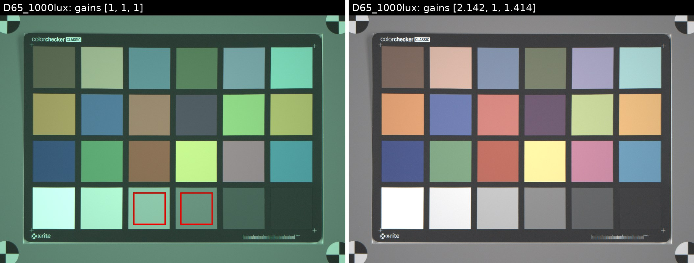
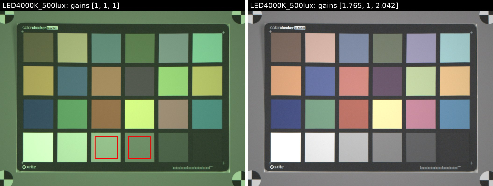
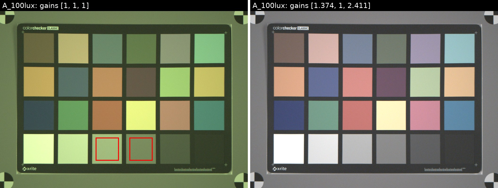

# COMP.SGN.360 Imaging Systems Laboratory: Assignment 1, White Balance

**Name:** _your name_  **Student number:** _your number_

## 1. Introduction

White balancing (WB) removes the colour cast of the illuminant and compensates for the unequal
sensitivities of the sensor's R, G and B channels. In our pipeline it is applied to the raw CFA
data after noise reduction, black level correction and lens shading correction, and before CFA
interpolation:

```
[R_WB; G_WB; B_WB] = diag(g_R, g_G, g_B) * [R; G; B]
```

The gains are estimated from a ColorChecker Classic captured with a Google Pixel 8 Pro
(10-bit raw, black level 64, white level 1023, 3072 x 4080 pixels, GBRG Bayer pattern)
under three illuminants: CIE D65 at 1000 lux, LED 4000K at 500 lux and CIE A at 100 lux.

## 2. Part 1: White balance gains

### 2.1 Method (`calculateWhiteBalance.m`)

1. The ColorChecker raw image of the selected illuminant is passed in as `input_image`.
2. A region of about 80 % of patches 21 and 22 is extracted:
   - patch 21: rows 1871-2066, columns 1811-2006
   - patch 22: rows 1871-2066, columns 2097-2292

   The function also checks the position of the white patch 19 and rotates the image by 180°
   if the capture was upside down.
3. For each region the mean R, G and B values are computed. Because the region starts on an odd
   row and column, its top-left pixel is a G pixel of the GBRG pattern, so
   `G = (1:2:end, 1:2:end)` and `(2:2:end, 2:2:end)`, `B = (1:2:end, 2:2:end)`,
   `R = (2:2:end, 1:2:end)`.
4. Gains per patch: `gain_R = G_avg / R_avg`, `gain_G = 1`, `gain_B = G_avg / B_avg`.
5. The gains of patches 21 and 22 are averaged.
6. The result is returned as `wb_gains = [gain_R, gain_G, gain_B]`.

### 2.2 Results

| Illuminant | gain_R | gain_G | gain_B |
|---|---|---|---|
| CIE D65, 1000 lux | 2.142 | 1 | 1.414 |
| LED 4000K, 500 lux | 1.765 | 1 | 2.042 |
| CIE A, 100 lux | 1.374 | 1 | 2.411 |

The gains were stable across the four captures of each illuminant (variation below 0.01).
The figures below show the raw ColorChecker with the extracted regions (red boxes) and gains
[1, 1, 1] on the left, and the same image with the calculated gains on the right. (Simple
preview: half-resolution demosaic and gamma 2.2, no colour correction.)





The gains follow the spectra of the illuminants. D65 contains a lot of blue, so the blue
gain is the smallest and the red gain the largest. CIE A (2856 K tungsten) has little blue
energy, so the blue gain is the largest (2.41) and the red gain the smallest. LED 4000K lies
in between. Both gains are above 1 for every illuminant because the green channel is the most
sensitive one (its spectral response is the widest and sits in the middle of the visible range).

### 2.3 Why patches 21 and 22 instead of white or black?

- **No clipping.** The white patch (19) reflects about 90 % of the light, so at least one
  channel can reach or approach saturation (1023). A clipped channel underestimates its mean
  and gives a wrong ratio. Patches 21 and 22 (about 36 % and 20 % reflectance) stay well inside
  the linear range of the sensor.
- **Good signal-to-noise ratio.** The black patch (24) gives values close to the black level,
  where read noise, dark current and any remaining black-level error dominate. Small absolute
  errors there turn into large errors in G/R and G/B. The mid-grey patches have plenty of signal.
- **Spectrally flat.** Patches 21 and 22 are designed to be spectrally neutral, so the ratio
  between channels reflects only the illuminant and the sensor, not the patch.
- **Two patches** at different levels average out noise and small non-linearities and
  reflectance deviations of a single patch.

### 2.4 Why should the patch start on an odd row and column?

The raw image is a Bayer mosaic that repeats every 2 x 2 pixels (GBRG for this sensor).
MATLAB indexing starts at 1, so pixel (1,1) is G, (1,2) is B, (2,1) is R and (2,2) is G.
If the extracted region starts on an odd row and odd column, it has the same 2 x 2 phase as
the full image, and the sub-sampling `(1:2:end, 2:2:end)` etc. picks out the correct colour
channel. If the region started on an even row or column, the pattern would be shifted (for
example to RGGB or BGGR) and R, G and B values would be mixed up, giving wrong gains.

## 3. Part 2: Gain comparison and analysis

_Insert the simulator output images here. Label each one with the gains used._

| Image | Calculated gains | Default gains (`[]`) | Gains [1, 1, 1] |
|---|---|---|---|
| test_D65_1000lux | _image_ [2.142, 1, 1.414] | _image_ [default] | _image_ [1, 1, 1] |
| test_LED4000K_500lux | _image_ [1.765, 1, 2.042] | _image_ [default] | _image_ [1, 1, 1] |
| test_A_100lux | _image_ [1.374, 1, 2.411] | _image_ [default] | _image_ [1, 1, 1] |

### 3.1 What does it mean when the simulator uses gains [1, 1, 1]?

It means that no white balancing is done: every channel is multiplied by one and passed on
unchanged. The image therefore keeps both the colour of the illuminant and the unequal channel
sensitivities of the sensor. Because the green channel is the most sensitive, all images get a
strong green cast. Under CIE A it is yellow-green (little blue), under D65 green-cyan (little red),
as can be seen in the left-hand images above. Grey objects are no longer grey, and the later colour
correction matrix, which assumes white-balanced input, cannot fix the colours properly.

### 3.2 Calculated gains vs. default gains

_Describe what you see after running the simulator. Points to look for:_

- If the default gains are tuned for one illuminant (often D65), the D65 result should look
  very similar to the one with calculated gains, while A and LED 4000K will show a remaining
  colour cast (for example a yellow/orange tint under A, because the default blue gain is too low).
- The differences are caused by:
  - the default gains being fixed values that are not measured for the actual illuminant of the scene;
  - the real light sources differing from the ideal CIE spectra (the measured `Live` spectra in
    `dataset/Measurement data` do not exactly match the `Target` spectra);
  - noise, small lens-shading residuals and the choice of patches in the calculated gains.
- Our calculated gains are within about 4 % of the as-shot white balance stored in the DNG files
  by the phone (A: [1.364, 1, 2.393], D65: [2.056, 1, 1.418], LED: [1.744, 1, 2.044]), which
  supports that the method and patch selection are correct.

## 4. Conclusion

A chart-based white balance using ColorChecker grey patches 21 and 22 gives stable gains for
all three illuminants. The gains match the illuminant spectra and the phone's own white balance,
and they make the grey patches neutral. Without white balancing ([1, 1, 1]) the images show a
strong colour cast, which shows why the block is needed before demosaicing and colour correction.
